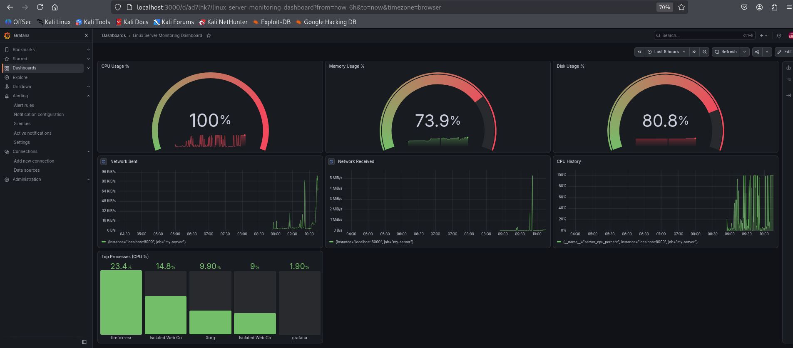
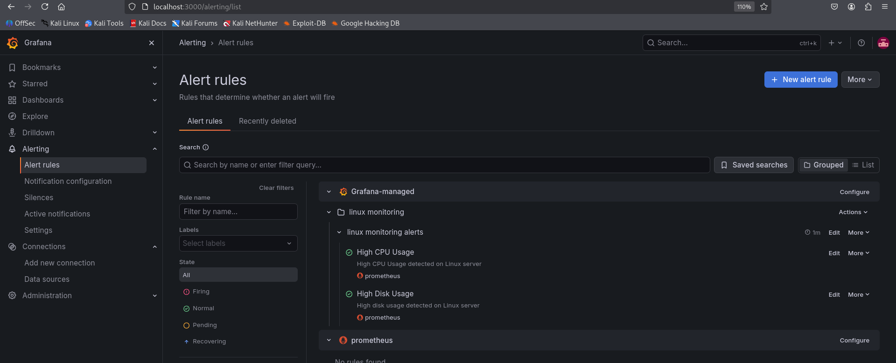
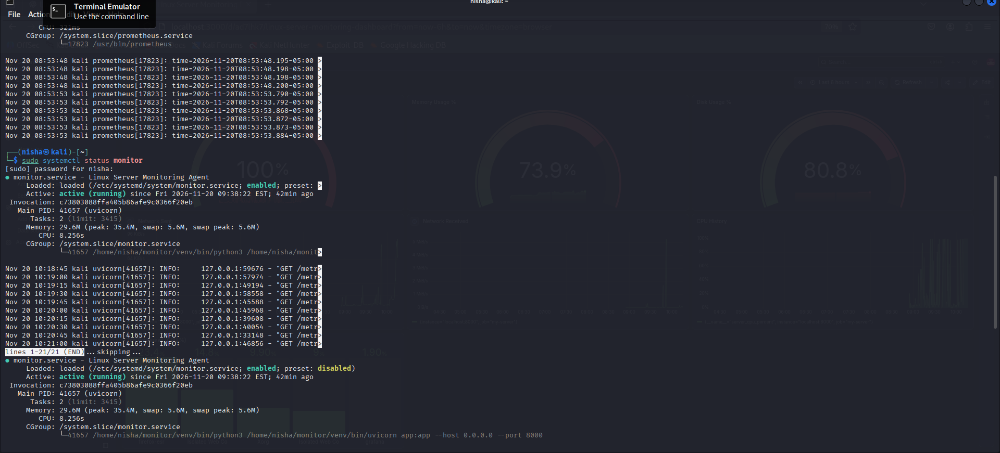
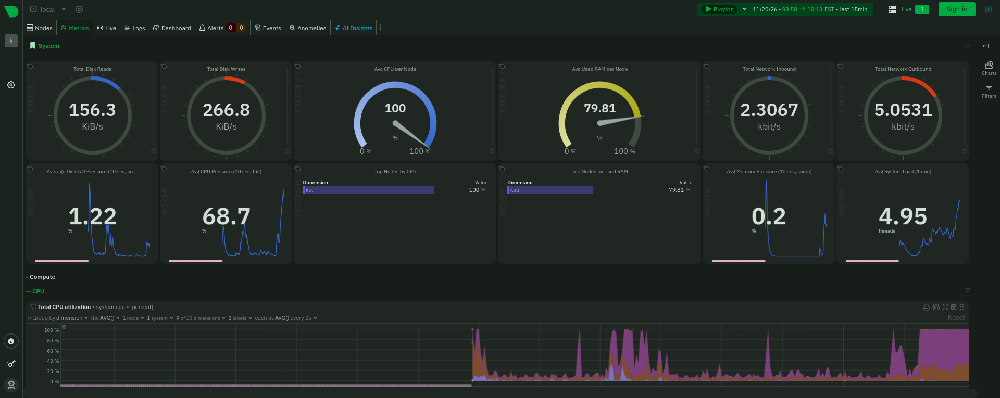

# Linux Server Monitoring and Alerting Dashboard

A monitoring system for a Linux server. It collects CPU, memory, disk,
network and top-process data, shows it on a Grafana dashboard, and sends
Telegram alerts when usage is too high.

## Architecture

## Tools used
Python, psutil, FastAPI, Uvicorn, Prometheus, Grafana, systemd, Netdata,
Telegram Bot, Kali Linux (VirtualBox)

## Features
- Live CPU, memory and disk gauges
- Network sent/received graphs and CPU history
- Top 5 processes by CPU
- Alerts to Telegram: High CPU (above 80%) and High Disk (above 90%)
- Runs as a systemd service: starts on boot and restarts if it crashes

## Dashboard

## How it works
1. app.py reads system data with psutil and exposes it at /metrics.
2. Prometheus scrapes /metrics and stores the values over time.
3. Grafana reads from Prometheus and draws the dashboard.
4. Grafana alert rules send a message to Telegram when a limit is crossed.

## How to run
1. python3 -m venv venv && source venv/bin/activate
2. pip install psutil fastapi uvicorn prometheus-client
3. uvicorn app:app --host 0.0.0.0 --port 8000
4. Add this job to /etc/prometheus/prometheus.yml and restart Prometheus:

        - job_name: 'my-server'
          static_configs:
            - targets: ['localhost:8000']

5. In Grafana, add Prometheus (http://localhost:9090) as a data source
   and build the panels.

## Monitoring Screenshots

### Grafana Dashboard

### Alert Rules

### Telegram Notifications

Note: to demonstrate the disk alert, I temporarily lowered the threshold
to 80% (disk was at 81.5%). The normal setting is 90%.

### Alert behavior
- An alert fires only after the value stays above the threshold for 1 minute
  (pending period), so short spikes do not cause false alarms.
- A Telegram message is sent when an alert starts firing and again when it
  resolves. While it keeps firing, Grafana repeats the message only at the
  repeat interval (default 4 hours) so the chat is not spammed.
- Slow-changing metrics like disk usage fire once and stay firing until the
  value drops below the threshold.
- Rules treat "No data" as Normal, so a stopped data source does not send
  false alerts.

## systemd service
The app runs as a service named monitor, so it starts on boot and restarts
after a crash.

## Comparison with Netdata
### Netdata Dashboard

| | My setup | Netdata |
|---|---|---|
| Setup effort | Required configuring Python, FastAPI, Prometheus, Grafana and alert rules separately | Installed using the Netdata installer and provided a dashboard automatically |
| Customization | Created custom metrics, Grafana panels and threshold-based Telegram alerts | Provides built-in dashboards, metrics and monitoring views |
| Resource use | Lightweight custom monitoring agent using psutil | Provides a broader built-in monitoring interface with many metrics |
## What I learned
- How Prometheus scrapes metrics and Grafana visualizes them
- Writing alert rules and connecting them to Telegram
- Running an app as a systemd service
- Problems I faced: Prometheus was not enabled on boot, so Grafana showed
  "No data" until I enabled it. Short CPU spikes did not trigger alerts
  until I understood the pending period.
